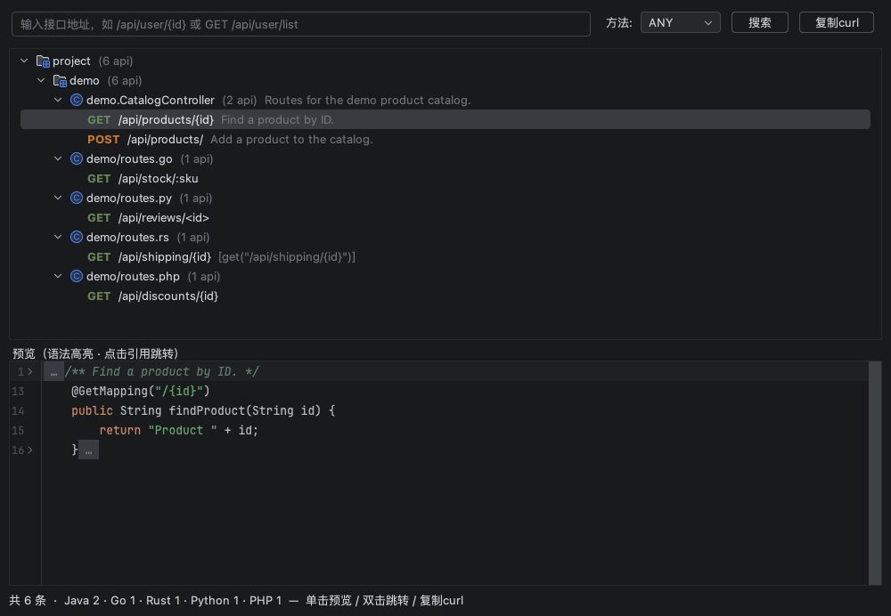
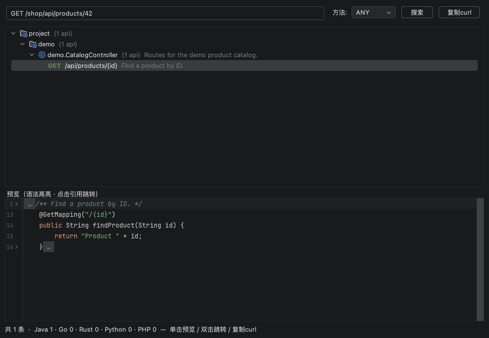

# API Finder

API Finder 是 [JTools](https://github.com/lhstack/JTools) 的路由查找扩展。输入一个 HTTP 路径，就能从当前项目的源码中定位对应的处理函数。它做的是**静态查找**：不需要启动服务，也不会发送 HTTP 请求。

源码仓库：[jtools-plugins/jtools-api-finder](https://github.com/jtools-plugins/jtools-api-finder)（`master` 分支）。

## 安装

1. 在 IntelliJ IDEA 中安装并启用 [JTools](https://plugins.jetbrains.com/plugin/com.lhstack.tools)；确保 IDE 的 Java 插件已启用。
2. 按下文构建 `build/libs/api-finder-0.0.1-plugin.jar`。
3. 在 **JTools 的插件管理**中从本地安装此 JAR，再打开 **API Finder** 面板。该 JAR 是 JTools 扩展，不通过 IntelliJ IDEA 的「从磁盘安装插件」入口安装。

## 使用

- **搜索路由**：输入 `/api/products/{id}` 或 `GET /shop/api/products/42`，按回车或点击「搜索」。也可以用下拉框指定 HTTP 方法；如果输入里已带方法前缀，以输入为准。
- **浏览全部**：留空并将方法设为 `ANY` 后搜索。结果按目录、类或文件组织；可识别的 Java 依赖路由按 JAR 分组。
- **查看源码**：单击路由叶节点预览处理函数，双击跳转到源码位置。Java 预览支持语法高亮，对可解析的 Java 引用也可点击跳转。
- **复制 cURL**：选中路由后点击「复制curl」。生成的命令默认指向 `http://localhost:8080`；执行前按需修改地址、替换 `{id}` 等路径参数，并补齐请求体或认证信息。

路径可用实际值或参数模板查询，例如 `/api/products/42` 和 `/api/products/{id}`。常见参数写法包括 `{id}`、`:id` 和 `<id>`。若配置文件声明了 `context-path`（例如 `/shop`），可以带该前缀搜索；结果树显示源码里声明的路径，生成的 cURL 保留匹配到的前缀。

## 截图

**浏览全部路由**：空查询找到 6 条示例路由，覆盖 Java、Go、Rust、Python 和 PHP。



**按方法和路径搜索**：`GET /shop/api/products/42` 命中 `GET /api/products/{id}`，预览 `CatalogController.findProduct`。



两张图均来自 IntelliJ IDEA 2025.3.3 独立沙箱中正在运行的 Swing 面板，使用虚构路由数据。

## 路由识别范围

| 语言 | 支持的常见声明形式 |
| --- | --- |
| Java | Spring MVC、Micronaut、JAX-RS 注解；支持部分组合注解，可查找 IDE 可索引的 Java 依赖 JAR |
| Go | Gin / Echo、Chi、`net/http` 的常见路由注册写法 |
| Rust | Axum / Actix Web 的常见路由注册与属性宏 |
| Python | Flask / FastAPI 的路由装饰器，Django 的 `path` / `re_path` |
| PHP | Laravel / Slim 的常见路由注册，以及 Symfony 的 `#[Route]` |

Java 通过 IntelliJ PSI 扫描；其余语言通过源码中的常见写法匹配。动态拼接的地址、运行时注册的路由和部分分组前缀可能无法识别。JTools 的函数调用接口也提供 `find_api`，接收 `path` 和可选的 `method`，返回匹配数量、语言、方法、路径、文件位置和函数名。

## 从源码构建

准备 JDK、Gradle 和 JTools SDK。已验证的组合是 **JDK 21、Gradle 8.8 和 IntelliJ IDEA 2025.3.3**；请用 Gradle 8.8 执行下面的构建命令。SDK 可从 JTools 的开发面板执行「安装开发依赖」获取，默认位置是 `~/.jtools/sdk/sdk.jar`。

```bash
git clone --branch master https://github.com/jtools-plugins/jtools-api-finder.git
cd jtools-api-finder
gradle clean shadowJar
```

默认使用 IntelliJ IDEA Community 2022.3 作为编译平台；也可用下面的命令指定本地 IDE 和 SDK（路径请替换为实际值）：

```bash
gradle clean shadowJar \
  '-PintellijPlatformLocalPath=/path/to/IntelliJ IDEA.app/Contents' \
  '-PjtoolsSdk=/path/to/sdk.jar'
```

安装 `build/libs/api-finder-0.0.1-plugin.jar`。该 JAR 包含 Gson，不包含 JTools SDK 或 IntelliJ 平台类。

## 开发文档

想了解这个插件如何从需求变成可运行的项目？参阅 [开发流程：用 Qoder 和 JTools 开发 API Finder](docs/development.md)，其中记录了模型选择、项目技能安装、Debugger MCP 配置，以及如何在独立沙箱中调试和迭代。

## 沙箱验收

- 空查询返回 6 条路由：Java 2 条，Go、Rust、Python、PHP 各 1 条。
- `GET /shop/api/products/42` 返回 1 条结果，选中后显示 `findProduct` 的 Java 源码；同一路径改用 `POST` 过滤返回 0 条。
- 生成的 cURL 包含 `GET`、`/shop` 前缀和 `{id}` 占位符；未执行请求，也未覆盖系统剪贴板。
- 直接调用 `find_api` 返回 1 条结果，定位到 `demo/CatalogController.java:14` 的 `CatalogController.findProduct`。
- 本次未覆盖依赖 JAR 扫描、源码跳转或其他 IDE 版本。

## 许可证

API Finder 项目采用 [Apache License 2.0](LICENSE)（`Apache-2.0`）。JTools、开发技能和第三方依赖仍适用各自的许可证。
